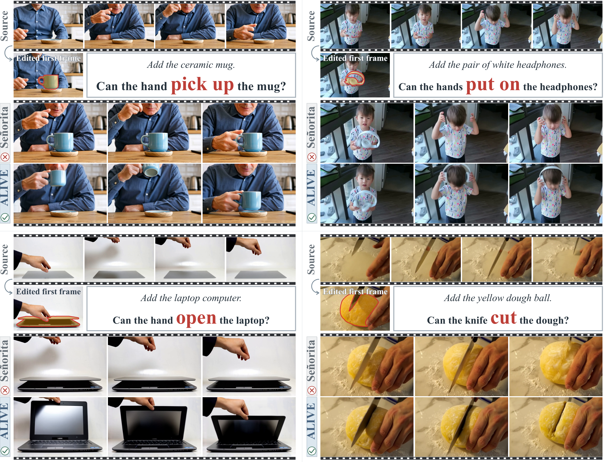

# ALIVE: Interaction-Aligned Object Insertion for First-Frame-Guided Video Editing

Zhenghong Zhou · Zhe Lin · Jiebo Luo · Yuqian Zhou 
University of Rochester · Adobe Research

[Paper](https://arxiv.org/abs/2610.08779) · [Project Page](https://real-time-video-research.github.io/alive/)

